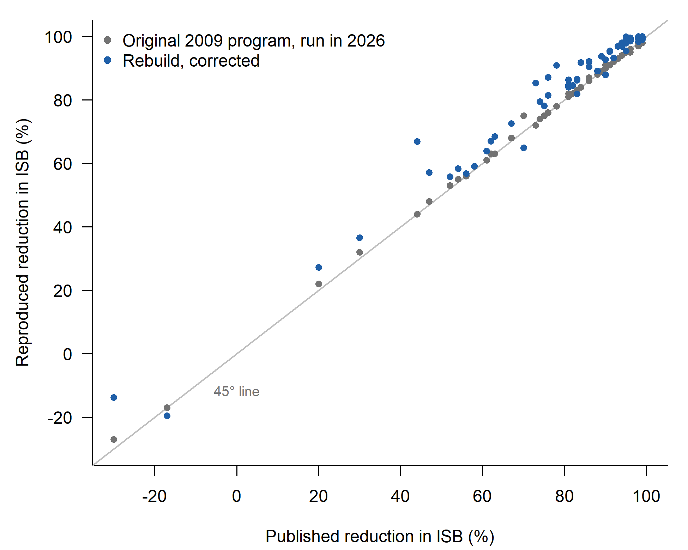
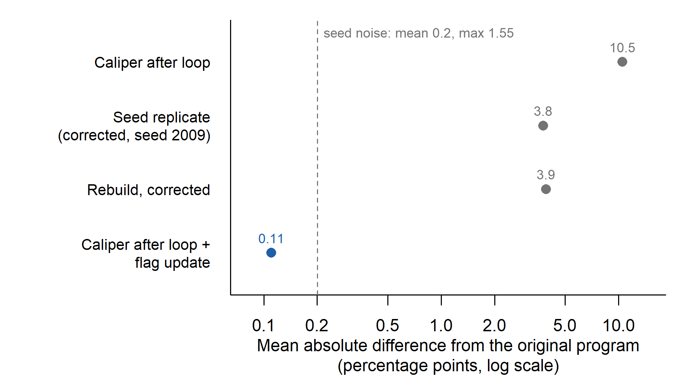
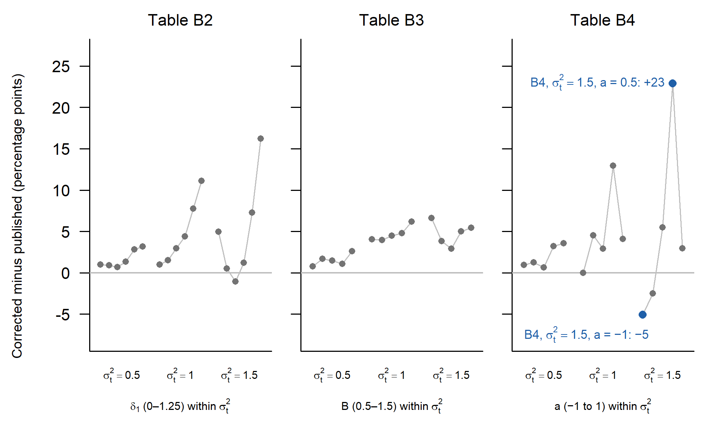

# Matching with local and non-local control groups: An R rebuild of Stuart and Rubin’s (2008) simulation

[Qiu Wang](https://orcid.org/0000-0003-1635-8050) (Syracuse University) · Version 1.1.0 · November 2026 · [doi:10.5281/zenodo.24186060](https://doi.org/10.5281/zenodo.24186060)

Text and figures: [CC BY 4.0](../LICENSE-report). Code: [MIT](../LICENSE). How to reproduce every number: the [README](../README.md).

## Abstract

Stuart and Rubin (2008) proposed matching treated units first to a local control group and, for units without a close local match, to a non-local group, with an adjustment for the difference between the two control groups. Their Appendix B simulation reports that the method removes 80.6% of initial squared bias on average. I rebuilt the simulation from the paper’s text alone and ran the original 2009 program at full scale (1,800 settings, 500 replications, 50 imputations). The original program reproduces the published tables to within half a percentage point on average over 71 cells. The rebuild removes 84.3%. The difference traces to two implementation details of the 2009 program: where the caliper is applied in the matching loop, and how one line updates the matched-control flags. With both added, the rebuild matches the original program to within 0.11 points per cell on average, below seed-to-seed noise. The method in Appendix A is unaffected; implemented as described, it performs somewhat better than published (84.3% vs 80.6% on average). Code, results and this report are public.

*Keywords:* matching, non-local control groups, replication, simulation study, multiple imputation

## 1. Question

Stuart and Rubin (2008; SR08) proposed matching treated units first to a local control group and then, for units with no close local match, to a non-local group, with an adjustment for the difference between the two control groups. In school-based program evaluations, a treated student's own school can have few good comparison students, while nearby schools offer a much larger pool.

Their Appendix B reports a simulation in which the method removes 80.6% of the initial squared bias (ISB) on average (p. 296). In 2009 I ran a replication of Appendix B for my dissertation work and could not reproduce the published results. I returned to the question in 2026, before applying and extending the method to school-based program data. This report asks two questions:

1. Does an independent rebuild of the simulation, written from the paper's text alone, reproduce the published tables?
2. If not, what causes the gap, and does it affect the method or only the published simulation?

## 2. The SR08 design

The rebuild follows the design of Appendix B and the procedure of Appendix A. Table 1 summarizes it in the ADEMP structure for simulation studies, which reports aims, data-generating mechanisms, estimands, methods and performance measures (Morris et al., 2019; Siepe et al., 2024); the details follow.

**Table 1**

*ADEMP Summary of the Simulation Study*

| Element | This study |
| --- | --- |
| Aims | Check whether the simulation in Appendix B of Stuart and Rubin (2008) can be reproduced from the paper's text, and explain any gap. |
| Data-generating mechanisms | XT ~ N(B/2, σ²t), XC1 ~ N(−B/2, 2 − σ²t), C2 effectively infinite; E(Y \| X, D) = γ + exp(aX) + (δ0 + δ1·X)·D; 1,800 settings (the grid below), 500 replications each. |
| Estimands | The treatment effect, which is zero in every setting. |
| Methods | Local/non-local matching with the adjustment of Appendix A and 50 imputations: the corrected rebuild, the variants that add the original program's two details, and the sensitivity variants (Sections 3 and 4.4); and the original 2009 program, run in 2026. |
| Performance measures | Percent reduction in ISB (unstable when the initial ISB is near zero; see Limitations), averaged over the settings in each of the 71 cells of Tables B1–B4 and over all settings; the share of treated units matched in C1. Monte Carlo noise is measured by rerunning with a new seed (Section 3). |

*Note.* ADEMP = aims, data-generating mechanisms, estimands, methods and performance measures. T = treated units; C1 = local control group; C2 = non-local control pool; D = 1 for the non-local group and 0 otherwise. Source: Stuart and Rubin (2008), Appendices A and B.

- **Groups.** Treated units T, a local control group C1, and an effectively infinite non-local control pool C2. XT ~ N(B/2, σ²t) and XC1 ~ N(−B/2, 2 − σ²t), so B is the difference in covariate means.
- **Outcome model.** E(Y | X, D) = γ + exp(aX) + (δ0 + δ1·X)·D, where D marks the non-local group. The true effect is zero, and outcomes are mean responses with no residual variance, so bias is measured by ISB.
- **Matching.** Greedy 1:1 matching of T to C1 with a caliper of 0.2 SD, a width that removes most of the bias in a normally distributed covariate (Cochran & Rubin, 1973). Treated units without a C1 match within the caliper are matched to C2. Matched C1 units also get exact C2 matches, which form the C1:C2 sample.
- **Adjustment.** The group difference d is estimated from `lm(y ~ x + D)`, with an intercept, on the C1 and C2 controls. Y(0) for C2-matched units is imputed by multiple imputation (J = 50), drawing σ² from a scaled inverse-χ² distribution with n − (p + 2) degrees of freedom and d given σ² from its normal posterior, and the imputations are combined with Rubin's rules (Rubin, 1987).
- **Criterion.** Percent reduction in ISB, averaged over settings.
- **Grid.** δ0 = 0; δ1 ∈ {0, 0.25, 0.5, 0.75, 1, 1.25}; NT ∈ {100, 200}; NC1/NT ∈ {2, 5}; B ∈ {0.5, 0.75, 1, 1.25, 1.5}; σ²t ∈ {0.5, 1, 1.5}; a ∈ {−1, −0.5, 0, 0.5, 1}.
- **Scale.** 1,800 settings × 500 replications × 50 imputations.

Where the text leaves a choice open, the rebuild takes the reading below and tests the alternatives (Section 4.4):

- the caliper is 0.2 times the sample SD of X in the treated group, and it is applied inside the greedy loop, as each treated unit is matched;
- treated units are matched in random (draw) order;
- the d model includes an intercept, as the n − (p + 2) degrees of freedom imply;
- when a = 0, exp(aX) is kept as the constant 1 and the initial bias is defined from the difference in X. The alternative is the Rubin (1979) limit, V(X) = X.

## 3. Materials

**Published tables.** Tables B1–B4 of Stuart and Rubin (2008, pp. 302–303) give 71 cells, each the mean percentage reduction in ISB over the settings in that cell. Table B1 gives one-way margins, one cell for each value of δ1, NT, NC1/NT, B, a and σ²t, averaged over the other factors; Tables B2, B3 and B4 cross σ²t with δ1, B and a, respectively. The published overall mean, 80.6% (p. 296), is the mean over the 1,800 settings: in a balanced grid it equals the mean of each set of one-way margins in Table B1 (80.6 to 81 from the whole-number cells). The rebuild's 84.3% is computed the same way.

**The original 2009 program.** The original 2009 simulation program was provided by Elizabeth A. Stuart. It was run in 2026 with its simulation code unchanged, using 500 replications, 50 imputations and seed 2009. It uses δ0 = 1, a caliper of 0.2 times the true σt applied after the greedy loop, and the multiple-imputation difference in means. It is not part of this repository and is not redistributed (see Acknowledgment).

**The rebuild.** [R/sr08_appendixB.R](../R/sr08_appendixB.R) was written independently from the published description (Wang, 2026). It has a switch for each suspected difference from the original program; the two switches below were added after the original program had been run:

- `caliper_when = "after"`: greedy nearest-unused matching for every treated unit first, then pairs outside the caliper dropped (their controls stay used);
- `recycle_flags = TRUE`: the original program's way of updating the matched-control flags, written from a description of its behaviour;
- `d0`, `caliper = "true"`, `intercept`, `a0`, `order` and `seed` for the remaining choices.

The rebuild uses only base R and the bundled `parallel` package (R Core Team, 2025). Each variant ran on the full grid with seed 2008 and the L'Ecuyer-CMRG generator; on 13 worker processes each took 10 to 70 minutes. The per-setting results for every variant are in `results/sr08/results_all.rds`.

**Test fixed in advance.** Before the comparison was run, a variant was said to match the original 2009 program if the mean absolute difference over the 71 cells was under 1 point and no cell differed by more than 5. The two programs use different random draws (seed 2009 with Mersenne-Twister against seed 2008 with L'Ecuyer-CMRG), so each cell was expected to differ by 1–2 points (the measured seed-to-seed noise, below, was smaller).

**Monte Carlo error.** The tracked results hold one row per setting, not per replication, so Monte Carlo standard errors (Morris et al., 2019) are not reported. Instead, the corrected rebuild was rerun with a new seed (2009), and the seed-to-seed variation is taken as the Monte Carlo noise: a mean of 0.2 and at most 1.55 points per cell over the 71 cells, and 84.1% against 84.3% for the overall mean. A difference between sources matters only if it is clearly larger than this. The published cells, and the original program's cells in docs/three_way.md, are whole numbers; rounding alone adds about 0.25 points to a mean absolute difference that is near zero, so such differences were computed from unrounded values where they exist.

## 4. Results

Comparisons cover the 71 cells of Tables B1–B4. The full cell-by-cell comparison is in [docs/three_way.md](../docs/three_way.md), the verdict in [docs/replication_verdict.md](../docs/replication_verdict.md), and the sensitivity variants in [docs/sensitivity.md](../docs/sensitivity.md).

### 4.1 The rebuild does not reproduce the published tables

The original 2009 program reproduces the published tables, but the rebuild written from the paper does not (Table 2).

**Table 2**

*Mean Percentage Reduction in ISB and Agreement With the Paper, by Source*

| Source | Mean % ISB reduction | Share matched in C1 | Mean abs diff from paper | Cells > 5 points off |
| --- | --- | --- | --- | --- |
| Published (p. 296) | 80.6 | — | — | — |
| Original 2009 program, run in 2026 | 80.9 | 0.738 | 0.49 | 0 |
| Rebuild, corrected (caliper inside loop) | 84.3 | 0.819 | 4.0 | 16 |
| Rebuild, caliper after loop only | 71.7 | 0.740 | 10.2 | 26 |
| Rebuild, caliper after loop + flag update | 81.0 | 0.740 | 0.49 | 0 |

*Note.* Mean % ISB reduction is the mean over all 1,800 settings (the published value is from p. 296). The other columns compare the 71 cells of Tables B1–B4 with the paper, in percentage points. C1 = local control group; — = not applicable. Source: three_way.md.

The original 2009 program, run in 2026, reproduces the published tables (mean absolute difference 0.49 points, no cell more than 5 off). The rebuild, implemented as Appendix A describes, removes more bias: 84.3% on average, with 16 of 71 cells more than 5 points from the paper. Figure 1 plots each cell at its published value: the original program lies on the 45° line, and the corrected rebuild mostly above it.

**Figure 1**

*Published and Reproduced Percentage Reduction in ISB, by Cell*

*Note.* Each point is one of the 71 cells of Tables B1–B4, plotted at its published value. Grey points are the original 2009 program, run in 2026; blue points are the corrected rebuild. The line is the 45° line, where the reproduced value equals the published one; points above it remove more bias than published. Source: results_all.rds; three_way.md.

### 4.2 Two implementation details explain the gap

Two details of the original program affect which controls end up in the analysis:

1. **When the caliper is applied.** The original program applied it after the matching loop had finished. The rebuild applies it inside the loop, as each treated unit is matched.
2. **How the matched-control flags are updated.** After the loop, the original program used a condition computed over the treated units to update flags stored on the control units. The two lists have different lengths, and R silently reuses ("recycles") the shorter condition along the longer list. So the flags can be set on the wrong controls.

Together, these details have three effects:

- controls of rejected pairs mostly stay in the sample, both as matched controls and in the C1:C2 model for the C2 adjustment;
- some controls of good pairs are dropped;
- some treated units get both a C1 and a C2 match, so the control group is no longer 1:1 with the treated group.

The caliper after the loop alone does not reproduce the tables; with the flag update added, it does. The caliper after the loop alone fits the σ²t = 1 cells but falls well short at σ²t = 1.5 (overall mean 71.7, 26 cells more than 5 points off).

### 4.3 With both details, the rebuild matches the original program

With both details, the rebuild is closer to the original program than two runs of the corrected rebuild with different seeds are to each other (Table 3).

**Table 3**

*Agreement Between Sources Over the 71 Cells*

| Comparison | Mean abs diff | Max abs diff | Cells > 5 |
| --- | --- | --- | --- |
| **Caliper after loop + flag update vs the original 2009 program** | **0.11** | **0.54** | **0** |
| Caliper after loop + flag update vs paper | 0.49 | 4.1 | 0 |
| Original 2009 program vs paper | 0.49 | 4.5 | 0 |
| Caliper after loop only vs the original 2009 program | 10.5 | — | 28 |
| Rebuild, corrected vs the original 2009 program | 3.9 | — | 13 |
| Monte Carlo noise: rebuild, corrected, seed 2009 vs seed 2008 | 0.2 | 1.55 | 0 |

*Note.* Differences are in percentage points; cells > 5 counts the cells that differ by more than 5 points. The row in bold is the test fixed in advance (mean under 1 point, no cell over 5). — = not reported. Source: replication_verdict.md.

By the test fixed in advance, the result is a match. The difference from the original 2009 program is smaller than the rebuild's own seed-to-seed noise. The share of treated units matched in C1 is 0.738 for the original program and 0.740 for the rebuild with both details. Figure 2 shows each variant's mean absolute difference from the original program against the seed-to-seed noise: only the rebuild with both details falls below it.

**Figure 2**

*Mean Absolute Difference From the Original 2009 Program, by Variant*

*Note.* Each dot is the mean absolute difference over the 71 cells between a variant and the original 2009 program, on a log scale. Blue marks the rebuild with both details (caliper after loop + flag update); grey marks the other variants. The seed replicate is the corrected rebuild run with seed 2009, compared with the original program's whole-number cells. The dashed lines mark the seed-to-seed noise of the corrected rebuild over the 71 cells: mean 0.2 and maximum 1.55 points. Source: results_all.rds; three_way.md; replication_verdict.md.

The two details move some cells far more than others, and they do not always lower the reduction. Table 4 lists the cells where the corrected rebuild differs most from the published value.

**Table 4**

*Cells Where the Corrected Rebuild Differs Most From the Published Value*

| Cell | Paper | Original 2009 program | Caliper after loop + flag update | Rebuild, corrected |
| --- | --- | --- | --- | --- |
| B4, σ²t = 1.5, a = 0.5 | 44 | 44 | 44 | 67 |
| B2, σ²t = 1, δ1 = 1.25 | 76 | 76 | 77 | 87 |
| B4, σ²t = 1, a = 0.5 | 78 | 78 | 79 | 91 |
| B1, a = 0.5 | 73 | 72 | 73 | 85 |
| B1, δ1 = 1.25 | 47 | 48 | 48 | 57 |
| B2, σ²t = 1.5, δ1 = 1.25 | −30 | −27 | −27 | −14 |
| B4, σ²t = 1.5, a = −1 | 70 | 75 | 74 | 65 |

*Note.* Values are percentage reductions in ISB. The first six rows are the six cells where the corrected rebuild differs most from the paper; the last row is the largest loss, the only cell where the corrected rebuild removes more than 5 points less bias than published. Source: three_way.md.

The corrected method gains up to 23 points in one cell (Table B4, σ²t = 1.5, a = 0.5: 67 vs 44). It is not better everywhere: at σ²t = 1.5, a = −1 it gives 65 vs 70. Figure 3 shows the difference for every cell of Tables B2–B4: the correction matters most at σ²t = 1.5.

**Figure 3**

*Corrected Minus Published Percentage Reduction in ISB, Tables B2–B4*

*Note.* Each point is one cell. Within each table, cells are grouped by σ²t and ordered by the varied parameter (δ1, B or a); lines join cells within a group only. Table B1 is omitted because its cells are one-way margins with no σ²t grouping. The horizontal line marks no difference. Blue points mark the largest gain (B4, σ²t = 1.5, a = 0.5: +23 points) and the largest loss (B4, σ²t = 1.5, a = −1: −5 points). Source: results_all.rds; three_way.md.

### 4.4 Other choices tested

The other choices the text leaves open do not explain the gap (Table 5).

**Table 5**

*Sensitivity Variants of the Corrected Rebuild*

| Variant | Mean % ISB reduction | Share matched in C1 | Mean abs diff from paper |
| --- | --- | --- | --- |
| Corrected rebuild (seed 2008) | 84.3 | 0.819 | 4.0 |
| Caliper on the true σt | 84.3 | 0.819 | 4.0 |
| a = 0 convention V(X) = X | 84.4 | 0.819 | 4.0 |
| Seed 2009 | 84.1 | 0.817 | 3.8 |
| Treated matched largest X first | 87.6 | 0.846 | 7.0 |
| Caliper after loop only | 71.7 | 0.740 | 10.2 |

*Note.* Each variant ran on the full grid with 500 replications and 50 imputations. Mean % ISB reduction is the mean over all settings; mean abs diff from paper is over the 71 cells, in percentage points. C1 = local control group. Source: sensitivity.md.

- **No effect.** δ0 = 1 vs 0, a caliper on the true σt instead of the sample SD, the a = 0 convention, and a new seed all leave results within noise. Seed-to-seed noise is at most 1.55 points per cell. With δ0 = 1 the tables change by at most 1.4 × 10−14 points, because the intercept in the d model absorbs it.
- **Matching order.** The paper does not specify the order in which treated units are matched, so random order is the neutral reading. Matching the treated units largest X first raises the reduction to 87.6% and moves the rebuild further from the paper (7.0 points on average).
- **Intercept.** Keep it. Appendix A's n − (p + 2) degrees of freedom imply one, and dropping it breaks the Table B2 pattern. Without it, the mean reduction is 94.1%. At σ²t = 1.5, the reduction without the intercept rises from 69 (δ1 = 0) to 97 before falling to 73. The published values fall from 95 to −30. The rebuild with the intercept falls from 100 to −14.

## 5. Discussion

**The method stands.** The procedure in the paper's Appendix A is unaffected; only the simulation results in its Appendix B are. Implemented as Appendix A describes, the method removes more bias than the published simulation shows (84.3% vs 80.6% on average), so the published tables understate the bias reduction it achieves, by up to 23 points in one cell, though not in every cell. The gap came from two small implementation details in the 2009 program, not from the method.

**Comparing with the published tables.** Anyone who implements the method as described and compares it with Stuart and Rubin's (2008) tables should expect to differ from them by about 4 points on average, with 16 of 71 cells more than 5 points off. This holds for the reading taken here; matching the treated units largest X first, for example, gives 7.0 points. It is a property of the original simulation program, not an error in the implementation.

**Lesson.** A shorter logical vector used to index a longer one is silently recycled in R. A one-line check such as `stopifnot(length(flag) == length(x))` would have caught this. More generally, an independent rebuild from a paper's text, with a switch for each suspected difference, is an effective way to check a published simulation.

**Limitations.** The column for the original 2009 program comes from a 2026 run of that program, which is not included here, so it cannot be regenerated from this repository; the `recycle_flags` switch reproduces its behaviour from a description, not from its code. Percent reduction is unstable when the initial ISB is near zero, so `results/sr08/summary.md` also reports the mean initial and remaining ISB. The check covers the simulation in Appendix B only.

**Next steps.** I plan to apply and extend the method to school-based program evaluation data, using this checked implementation.

## Acknowledgment

The original 2009 simulation program was provided by Elizabeth A. Stuart. It was shared privately, and its results appear in this repository’s comparisons: the `original_2009` column in `docs/three_way.md` and the “Original 2009 program, run in 2026” row of the Results table come from running it in 2026 with its simulation code unchanged (only the number of replications, the random seed and file paths were set, and the settings were split across processor cores). My 2009 revisions of that program were also run for comparison. Neither her program nor my revisions of it are redistributed here, since they were shared on a do-not-distribute basis. All code in this repository was written independently from the published description in Stuart and Rubin (2008).

## AI assistance

Code, documentation and analyses were developed with Claude (Anthropic) as a coding assistant, under the author's direction. The author designed the study, checked the results and is responsible for the content.

## References

- Cochran, W. G., & Rubin, D. B. (1973). Controlling bias in observational studies: A review. *Sankhyā: The Indian Journal of Statistics, Series A, 35*(4), 417–446.
- Morris, T. P., White, I. R., & Crowther, M. J. (2019). Using simulation studies to evaluate statistical methods. *Statistics in Medicine, 38*(11), 2074–2102. https://doi.org/10.1002/sim.8086
- R Core Team. (2025). *R: A language and environment for statistical computing* (Version 4.5.1). R Foundation for Statistical Computing. https://www.R-project.org/
- Rubin, D. B. (1979). Using multivariate matched sampling and regression adjustment to control bias in observational studies. *Journal of the American Statistical Association, 74*(366), 318–328. https://doi.org/10.1080/01621459.1979.10482513
- Rubin, D. B. (1987). *Multiple imputation for nonresponse in surveys*. Wiley. https://doi.org/10.1002/9780470316696
- Siepe, B. S., Bartoš, F., Morris, T. P., Boulesteix, A.-L., Heck, D. W., & Pawel, S. (2024). Simulation studies for methodological research in psychology: A standardized template for planning, preregistration, and reporting. *Psychological Methods*. Advance online publication. https://doi.org/10.1037/met0000695
- Stuart, E. A., & Rubin, D. B. (2008). Matching with multiple control groups with adjustment for group differences. *Journal of Educational and Behavioral Statistics, 33*(3), 279–306. https://doi.org/10.3102/1076998607306078
- Wang, Q. (2026). *Matching with local and non-local control groups: An R rebuild of Stuart and Rubin’s (2008) simulation* (Version 1.1.0) [Computer software and report]. Zenodo. https://doi.org/10.5281/zenodo.24186060
